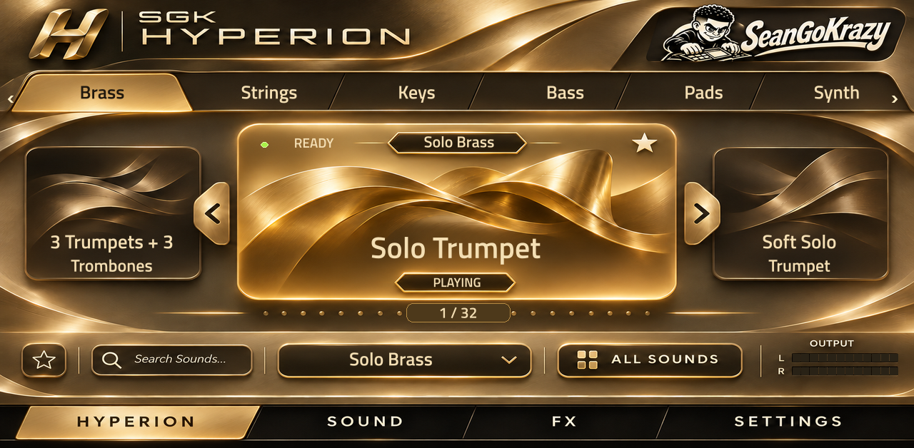

# SGK Hyperion

Independent C++ multi-engine instrument for ARMv7 MPC OS 3.x, with static gold artwork and native touchscreen controls. MIT licensed. Repository: https://github.com/seangokrazy/SGK-Hyperion.

## Release status
0.1.2 **prerelease candidate**. Based on the working private 0.1.2 engine, FX and GUI. The public copy adds configurable library paths and stripped binaries. The existing private development installation is separate from this public packaging workflow. Only ARMv7 Key 37/Hakai has isolated device validation; other devices and MPC OS 2.x/aarch64 are unverified. Hardware touch and standard-install/uninstall smoke checks remain before publication. `tested.json` stays empty until those checks are confirmed.

No sounds are included. This is a player, not a replacement licensed copy of a vendor instrument. Requires your own compatible ordinary, unwrapped content with Patches, Samples and optionally Wavetables. It does not load vendor VST binaries or decode protected wrappers. See [library setup](docs/LIBRARY-SETUP.md).

## Features
- PCM, prototype Analog/FM/Wavetable/additive Drawbar synthesis.
- Native category/bank browser, carousel, favorites, QWERTY search and meters.
- Sixteen visible browser rows. Browsing preserves playback until confirmation; arrows load adjacent filtered presets.
- Editable existing-preset FX rack: mix, per-stage bypass, trim, reset and MPC project recall.
- 52 active independent FX models plus bypass/None; these are approximations, not exact reference-matched algorithms.
- Parameter smoothing, fixed callback storage, off-thread patch preparation/destruction.

## Install
Download the `*-mpc-armv7.zip` release (when published). Save your MPC project before running its standard install.sh; installation restarts MPC. Root SSH on a compatible modified device is required; this is not an official Akai SDK package. Read INSTALL.md and the bundled Library Setup notes first. Stock Windows VST3 loading, Gen2/aarch64 support and MPC OS 2.x are not claimed.

## Use
Home Q1 category / Q2 preset preview / Q3 bank / Q4 output. Touch the carousel swipe rail for jog focus; confirm/tap center to play. Sound Q1 output / Q2 pan / Q3 preset-FX bypass. On FX, select a rack row; Q1–Q3 adjust its first three visible controls. FX edits are stored with MPC project state, do not overwrite source banks, and reset to the new preset's settings when changing sounds.

## Build and test
Linux ARM cross build: install CMake and arm-linux-gnueabihf-g++, then `sh Tools/build-armv7.sh`. It builds the player and library catalog tool. Verify your resulting glibc requirements with Open MPC's catalog checker before distributing. Use an MPC-compatible sysroot; newer host toolchains may exceed the device's libc.

Desktop core tests/catalog tool: `cmake -S . -B build/native -DCMAKE_BUILD_TYPE=Release`, `cmake --build build/native --config Release`, then `ctest --test-dir build/native -C Release --output-on-failure`. The MPC wrapper itself targets Linux; the portable engine/tool/tests build on Windows too.

The checked-in skin matches this candidate. Optional regeneration: install Pillow, run `python Source/GUI/generate_skin.py`; set HYPERION_FONT to a local bold TrueType font if needed. No font files are bundled. The static source artwork is under Resources.

## Performance and limits
The catalog-style benchmark returned WARN: p99 23.0%, worst 26.1% of a 128-frame block at 44.1 kHz, on the tested default patch with up to 16 notes. This is not a guarantee for all patches. Heavy layered FM can exceed that cost considerably. Existing 48 kHz probes measured an 8-note FM example around 57% of one core. Leave headroom when using several instances; see docs/VALIDATION.md.

Full original modulation/phrase/arp behavior, organ flavor matching, protected piano maps and Combi global-FX routing remain incomplete. The rack edits existing effects; it does not add arbitrary new routing or slots. Samples for the selected preset are RAM-resident, not hybrid streamed.

## Licensing
Code is MIT: see LICENSE. Open MPC-derived ABI/skin helper/installer components retain their notice in licenses/OpenMPC-MIT.txt. Sound content and vendor code are excluded; no rights to third-party banks are granted. SeanGoKrazy identity does not imply endorsement of third-party derivatives. See THIRD-PARTY-NOTICES.md.
